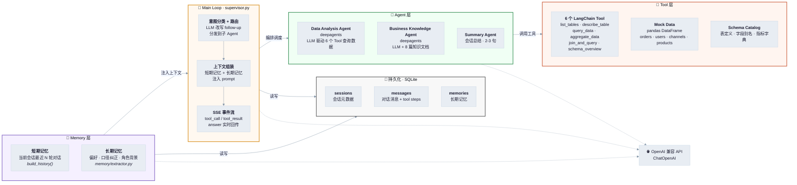

# Data Agent Chat

对话式数据问答 Agent。用户输入自然语言问题，Supervisor 根据语义路由到对应的子 Agent，查询 Mock 数据或调用 LLM 生成分析结论与业务知识回答。具备长期记忆能力，可自动提取用户偏好、口径纠正和背景信息。

## 架构

### 技术架构



**核心交互流程：**

```
1. 请求进入
   FastAPI 接收 POST /api/chat/stream
     → 从 messages 表读取历史消息 (短期记忆)
     → 调用 stream_supervisor(message, history)

2. Main Loop 编排
   classify_intent() → LLM 分类意图 + 改写 follow-up
   _build_memory_block() → 从 memories 表读取长期记忆注入 prompt
   build_history() → 最近 N 轮对话转为 LangChain 消息列表
     → 按路由分发到 DA / BK / both / out_of_scope

3. Agent 执行
   Data Analysis Agent: LLM 规划 → 调用 Tool → pandas 查询 → LLM 总结
   Business Knowledge Agent: LLM 直接基于知识库文本回答
     → 通过 astream_events 实时产出 tool_call / tool_result / answer 事件

4. 响应与持久化
   SSE 事件流回传前端 → 消息存入 messages 表
     → 异步触发 Memory Extractor → LLM 提取偏好/纠正/背景
     → 写入 memories 表 → 下次对话自动注入
```

- **React + TypeScript + Tailwind CSS**: 前端 UI（Vite 构建）
- **FastAPI**: HTTP 服务，提供 REST API 和 SSE 流式接口
- **LangGraph**: Multi-Agent 编排，Supervisor 模式
- **LangChain + OpenAI 兼容接口**: LLM 调用（支持任意 OpenAI 兼容的 API Gateway）
- **pandas DataFrame**: Mock 数据层，模拟真实数据库

### 各层职责

| 层 | 文件 | 核心职责 |
|------|------|------|
| Main Loop | `agents/supervisor.py` | 编排入口：意图分类 → 记忆注入 → 历史构建 → 路由分发 → SSE 事件流 |
| Agent 层 | `agents/data_analysis.py` | 基于 deepagents，LLM 驱动 6 个 Tool 查询数据 |
| Agent 层 | `agents/business_knowledge.py` | 基于 deepagents，LLM 直接使用知识库文本回答 |
| Agent 层 | `agents/summary.py` | 独立 LLM 调用，将会话总结为 2-3 句 |
| Tool 层 | `tools/query.py` | 6 个 LangChain Tool，封装 pandas 查询操作 |
| Tool 层 | `tools/mock_data.py` | 4 张 pandas DataFrame 模拟数据库 |
| Tool 层 | `schema/catalog.py` | 表定义、字段别名、指标字典，供 Tool 和 LLM 使用 |
| Memory 层 | `memory/extractor.py` | 后台 LLM 调用，从对话中提取偏好/纠正/背景，写入 memories 表 |
| Memory 层 | `session/store.py` | SQLite 三表存储：sessions / messages / memories |
| LLM 层 | `llm.py` | OpenAI 兼容 ChatOpenAI 配置，统一 temperature / retry 策略 |

### 两层记忆的协作

```
短期记忆 (build_history)
  └─ 来源: messages 表中当前会话的最近 N 轮对话 (默认 6 轮)
  └─ 注入: 作为 LangChain BaseMessage 列表传入 Agent
  └─ 作用: 让 Agent 理解对话上下文，解析 follow-up 中的指代

长期记忆 (memory/extractor)
  └─ 来源: 每轮对话完成后，异步 LLM 提取用户事实
  └─ 存储: memories 表 (user_id + key 唯一)
  └─ 注入: _build_memory_block() 将内容拼入 prompt 前缀
  └─ 作用: 跨会话记住用户偏好、口径纠正、角色背景
```

## 快速启动

### 1. 安装后端依赖

```bash
cd backend
pip install -r requirements.txt
```

### 2. 安装前端依赖并构建

```bash
cd web
npm install
npm run build
```

### 3. 配置环境变量

编辑 `backend/.env`：

```env
# LLM API 配置（OpenAI 兼容接口）
OPENAI_API_KEY=your_api_key
OPENAI_BASE_URL=https://your-api-gateway/v1
MODEL_NAME=your-model-name

# true = Mock 模式（不调用 LLM，使用规则匹配响应，适合开发测试）
# false = 真实 API 模式（调用 LLM，需要有效的 API Key 和网络）
USE_MOCK=false
```

### 4. 启动服务

```bash
cd backend
./start.sh
```

或手动启动：

```bash
cd backend
python3 -m uvicorn app.main:app --host 127.0.0.1 --port 3009 --reload
```

### 5. 访问

| 地址 | 说明 |
|------|------|
| `http://127.0.0.1:3009` | Agent Chat UI（构建后的 React 应用） |
| `http://127.0.0.1:3009/docs` | FastAPI 自动生成的 API 文档 |
| `http://127.0.0.1:3009/api/health` | 健康检查 |

### 开发模式（前端热更新）

如果需要前端开发模式（支持热更新），另开终端：

```bash
cd web
npm run dev
```

前端将运行在 `http://127.0.0.1:3008`，API 请求自动代理到后端 3009 端口。

## API 端点

| 方法 | 路径 | 说明 |
|------|------|------|
| `GET` | `/api/health` | 健康检查 |
| `GET` | `/api/schema` | 获取数据表 Schema 列表 |
| `POST` | `/api/chat` | 对话（JSON 请求/响应） |
| `POST` | `/api/chat/stream` | 对话（SSE 流式响应） |

`POST /api/chat` 请求体：

```json
{ "message": "最近30天销售额是多少？" }
```

## 示例问题

**数据分析类**（路由到 Data Analysis Agent）：
- 最近 30 天销售额是多少，哪个渠道贡献最大？
- 各地区订单量排名如何？
- 退款率怎么样？
- 新用户转化率如何？

**业务知识类**（路由到 Business Knowledge Agent）：
- 退款政策是什么？
- ROI 怎么计算？
- 企业版和专业版有什么区别？
- 转化率的定义是什么？

## 运行模式

### Mock 模式（`USE_MOCK=true`）

不调用 LLM，使用关键词匹配生成预设响应。适合无 API 访问时的开发和 UI 测试。

### 真实 API 模式（`USE_MOCK=false`）

通过 OpenAI 兼容接口调用 LLM。需要：
1. 有效的 API Key
2. 网络可访问 API Gateway
3. 模型已在 Gateway 上开通权限

## 目录结构

```text
data-agent-chat/
├── README.md                          # 本文件
├── backend/
│   ├── app/
│   │   ├── main.py                    # FastAPI 入口（服务前端 + API）
│   │   ├── llm.py                     # LLM 配置
│   │   ├── agents/
│   │   │   ├── supervisor.py          # Supervisor 编排（路由）
│   │   │   ├── data_analysis.py       # 数据分析 Agent
│   │   │   ├── business_knowledge.py  # 业务知识 Agent
│   │   │   └── summary.py             # 会话总结 Agent
│   │   ├── tools/
│   │   │   ├── query.py               # 查询工具（6 个）
│   │   │   └── mock_data.py           # Mock 数据（pandas）
│   │   ├── schema/
│   │   │   └── catalog.py             # Schema 目录
│   │   ├── knowledge/
│   │   │   └── loader.py              # 业务知识库加载
│   │   ├── memory/
│   │   │   └── extractor.py           # 长期记忆提取
│   │   └── session/
│   │       └── store.py               # SQLite 会话存储
│   ├── test.html                      # 备用简单测试页面
│   ├── requirements.txt
│   ├── .env                           # 环境变量配置
│   └── start.sh                       # 启动脚本
├── web/                               # React 前端
│   ├── src/
│   │   ├── App.tsx                    # 主布局
│   │   ├── components/
│   │   │   ├── ChatPanel.tsx          # 聊天面板
│   │   │   ├── Sidebar.tsx            # 侧边栏（示例问题 + Schema）
│   │   │   ├── InsightPanel.tsx       # 分析过程面板
│   │   │   ├── MessageBubble.tsx      # 消息气泡（支持 Markdown）
│   │   │   ├── StepDetail.tsx         # 工具调用步骤详情
│   │   │   ├── StarterCards.tsx       # 示例问题卡片
│   │   │   └── ThinkingStatus.tsx     # 思考状态指示器
│   │   ├── hooks/
│   │   │   ├── useChat.ts            # 聊天状态管理
│   │   │   ├── useSessions.ts        # 会话列表管理
│   │   │   ├── useMemories.ts        # 长期记忆管理
│   │   │   ├── useRecap.ts           # 会话总结
│   │   │   └── useTypewriter.ts      # 打字机效果
│   │   ├── lib/
│   │   │   ├── api.ts                # API 客户端
│   │   │   └── export.ts             # 导出功能
│   │   └── types.ts                   # TypeScript 类型
│   ├── index.html
│   ├── vite.config.ts
│   ├── tailwind.config.js
│   └── package.json
└── docs/
    └── project-plan.md                # 项目方案文档
```

## 后续扩展

- 替换 Mock 数据层为真实数据库（MySQL / PostgreSQL / ClickHouse / BigQuery）
- 增加更多子 Agent（如报表生成、数据导出）
- 接入向量数据库实现 RAG 业务知识检索
- 增加用户认证、查询权限控制、审计日志
